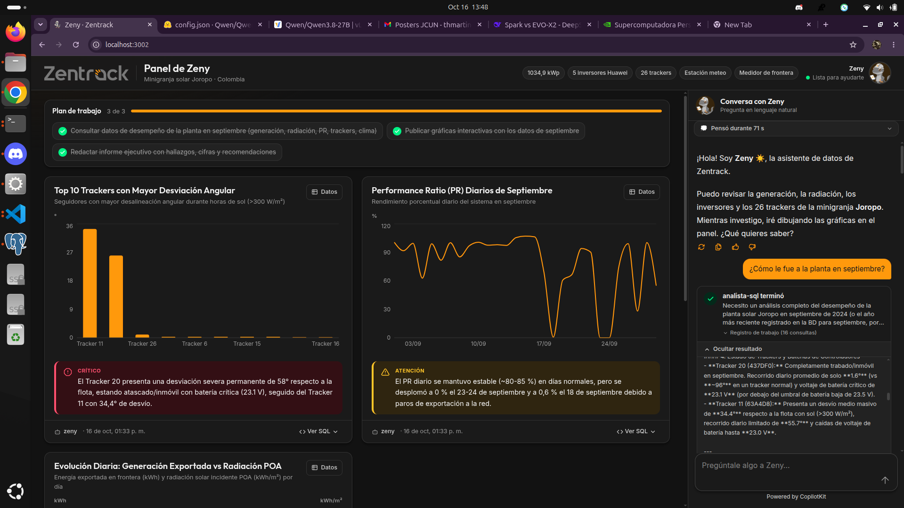

# Zeny — el cerebro de IA de la minigranja solar Joropo

> **Zeny** es un agente de IA que analiza los datos de una minigranja solar (generación, clima, inversores,
> seguidores solares), conversa en lenguaje natural con quien le pregunta y **dibuja gráficas en vivo** en el
> navegador mientras trabaja. Hoy es un analista de solo lectura; la meta es que sea el **cerebro de la
> minigranja**: vigilar, inferir y tomar decisiones técnicas que eviten daños (incendios, fallas de equipos)
> y optimicen la generación.

Proyecto de **Zentrack SAS** · Demo para **ExpoSolar Colombia**.



*La interfaz: a la izquierda el lienzo con el plan de trabajo y las gráficas que Zeny va publicando (con alertas
de severidad y "Ver SQL"); a la derecha el chat, donde se ve su razonamiento y las tarjetas de los subagentes.*

---

## Contenido

1. [¿Qué es Zeny y qué hace hoy?](#1-qué-es-zeny-y-qué-hace-hoy)
2. [Visión a futuro](#2-visión-a-futuro)
3. [Arquitectura y flujo de una pregunta](#3-arquitectura-y-flujo-de-una-pregunta)
4. [¿Qué es CopilotKit y AG-UI? Ventajas](#4-qué-es-copilotkit-y-ag-ui-ventajas)
5. [Los datos](#5-los-datos)
6. [Cómo ejecutarlo en local](#6-cómo-ejecutarlo-en-local)
7. [Probarlo: preguntas de ejemplo](#7-probarlo-preguntas-de-ejemplo)
8. [Configuración (`.env`)](#8-configuración-env)
9. [Observabilidad con Langfuse](#9-observabilidad-con-langfuse)
10. [Estructura del repositorio](#10-estructura-del-repositorio)
11. [Reiniciar y borrar](#11-reiniciar-y-borrar)
12. [Problemas frecuentes](#12-problemas-frecuentes)

---

## 1. ¿Qué es Zeny y qué hace hoy?

La minigranja **Joropo** (Colombia) tiene **1034,9 kWp** instalados, **5 inversores Huawei** (990 kW AC),
**26 trackers** (seguidores solares de eje único con su propio controlador y batería), una **estación
meteorológica** (irradiancia GHI/POA, viento, lluvia, temperatura de módulo, sensor de limpieza) y un
**medidor de frontera** en la subestación (energía realmente exportada a la red).

Hoy Zeny trabaja sobre un **conjunto de datos históricos (septiembre 2026)** cargado en Postgres, y puede:

- **Responder preguntas técnicas** en español: desempeño de la planta, Performance Ratio (PR), pérdidas AC,
  efecto térmico, suciedad, estado de los trackers, calidad de los datos.
- **Investigar en paralelo**: delega en subagentes SQL que consultan la base al mismo tiempo.
- **Graficar en vivo**: líneas, áreas, barras, mapas de calor, calendarios, donas, medidores, bandas, KPIs y
  tablas, cada una con un *insight* y un nivel de severidad (`info` / `alerta` / `crítico`).
- **Ser honesta con los datos**: "sin dato" no es cero, las causas se plantean como hipótesis a verificar en
  campo, y nunca inventa eventos que no estén en los datos.

> **Alcance actual (v0):** solo **lectura y análisis**. Zeny no controla ningún equipo, no recibe telemetría en
> vivo y no emite alertas por sí sola. Eso es la hoja de ruta (sección 2).

---

## 2. Visión a futuro

La idea es que Zeny evolucione de analista a **cerebro operativo de una minigranja solar**:

| Etapa | Qué incorpora |
|---|---|
| **Hoy** | Análisis de datos históricos cargados desde reportes `.xlsx`; gráficas y conversación vía AG-UI. |
| **Telemetría en vivo** | Conexión directa a los datos que la minigranja genera en tiempo real (en vez de cargar archivos). |
| **Clima e inferencia** | Cruzar datos de la planta con pronóstico y clima para anticipar generación, viento fuerte, lluvia, etc. |
| **Monitoreo y reglas de seguridad** | Detección de condiciones peligrosas (sobretemperatura, baterías críticas, trackers trabados, caídas anómalas de PR) con **reglas fijas y deterministas**; el agente las prioriza, correlaciona y explica. |
| **Acciones controladas** | APIs de los controladores de trackers, shelters (subestación) e inversores. Zeny **propone** una acción técnica, un **humano la aprueba** y queda registrada. |
| **Prevención de daños** | Decisiones técnicas que eviten incendios y daños (p. ej. llevar los trackers a posición de defensa ante viento > 15 m/s, aislar un equipo con comportamiento anómalo). |
| **Interfaz para inversores** | A través del protocolo **AG-UI**, los inversores y operadores de la minigranja le preguntan en lenguaje natural cosas técnicas y de generación de energía ("¿cuánto generamos este mes frente a lo esperado?", "¿hay algún equipo que ponga en riesgo la inversión?") y reciben respuestas con gráficas verificables. |

**Principio de diseño** (ver [`docs/PLAN.md`](docs/PLAN.md)):

> **El código calcula y vigila; el agente supervisa, explica y propone; el humano aprueba.**

Una regla de seguridad no puede depender de un LLM: las condiciones críticas las detecta código determinista;
el agente las supervisa, las cruza con otros datos y las explica. Y toda acción sobre equipos reales pasará
por aprobación humana con registro de auditoría.

---

## 3. Arquitectura y flujo de una pregunta

```text
Navegador :3002 (Next.js + CopilotKit)  ──AG-UI──►  Backend :8100 (FastAPI + LangGraph)
  lienzo de gráficas  ◄── STATE_SNAPSHOT ──             Zeny (principal): write_todos · task · crear_grafica
  chat + tarjetas de subagentes                          └─ analista-sql ×N en paralelo: ejecutar_sql
                                                                    │ solo lectura (zeny_lector)
                                                         Postgres zeny-db :5434  ◄── ETL de los .xlsx
                                                                    LLM: vLLM (Qwen3) o Gemini
```

### Los agentes

| Agente | Rol | Herramientas |
|---|---|---|
| **Zeny** (principal) | Conversa, planea, delega y **crea las gráficas**. No tiene acceso directo a la base. | `write_todos` (plan visible), `task` (delegar en subagentes), `crear_grafica` |
| **analista-sql** (subagente) | Investiga los datos: escribe y ejecuta SQL, devuelve hallazgos con cifras y consultas verificadas. Se pueden lanzar **varios en paralelo** (máx. 3). | `ejecutar_sql` (solo lectura, máx. 60 filas al LLM) |

Construidos con **LangChain/LangGraph** y los *middlewares* de **deepagents** (`SubAgentMiddleware` → tool
`task`; `TodoListMiddleware` → plan visible). Ver [`backend/app/agents/zeny.py`](backend/app/agents/zeny.py).

> Los subagentes **arrancan sin memoria**: no ven la conversación ni lo que encontró otro analista. Por eso
> el prompt de Zeny obliga a que cada `task` sea **autocontenida** (pregunta, fechas, filtros, contexto y
> la gráfica que se quiere).

### Flujo paso a paso

1. El usuario escribe en el chat (`CopilotChat`). El frontend envía la conversación por **AG-UI** (`POST /agui`).
2. Zeny escribe un **plan** con `write_todos` → el frontend lo muestra arriba ("Plan de trabajo 3 de 3").
3. Zeny delega con `task` en uno o varios **analista-sql** (en paralelo). Cada uno consulta Postgres con el
   rol de solo lectura y devuelve hallazgos + SQL verificado. En el chat se ven como **tarjetas** con su
   razonamiento y los pasos `SQL → … ← N filas`.
4. Con eso, Zeny llama a `crear_grafica(sql, tipo, x, series, insight, severidad…)`. El **backend** ejecuta el
   SQL, arma la gráfica y la publica en el **estado compartido** (`charts`). Los datos de la gráfica **no
   entran al contexto del LLM** (solo un resumen corto): viajan directo al navegador.
5. El backend emite `STATE_SNAPSHOT` y el lienzo dibuja cada gráfica **en cuanto se crea**, mientras Zeny sigue
   trabajando.
6. Zeny responde en el chat: conclusión primero, 2–4 puntos con cifras y una recomendación.

### Contrato backend ↔ frontend

Todo viaja por AG-UI: mensajes, *tool calls*, **razonamiento** (`REASONING_*`), eventos de **subagentes**
(`SUBAGENT_STARTED/FINISHED`, cada evento etiquetado con `subagentRunId`) y el **estado compartido**
(`charts`, `todos`). El detalle de eventos, tipos de gráfica y formas de `datos` está en
[`docs/CONTRATO_UI.md`](docs/CONTRATO_UI.md); hay streams reales capturados en `docs/ejemplo_stream_*.sse`
para probar el frontend sin backend.

---

## 4. ¿Qué es CopilotKit y AG-UI? Ventajas

### AG-UI (Agent–User Interaction Protocol)

Un **protocolo abierto** para conectar un agente de IA con una interfaz de usuario. En lugar de que cada
proyecto invente su propio formato, el agente emite un **flujo de eventos tipados** por HTTP (SSE): texto en
streaming, llamadas a herramientas, razonamiento, actividad de subagentes y **sincronización de estado**.

### CopilotKit

Un **framework de frontend (React/Next.js)** para construir "copilotos" e interfaces de agentes. Habla AG-UI,
así que el navegador se conecta **directamente** al backend Python (`HttpAgent` apuntando a `/agui`), sin
runtime intermedio (ver [`frontend/app/providers.tsx`](frontend/app/providers.tsx)).

### Qué ganamos

| Ventaja | En Zeny |
|---|---|
| **Streaming en vivo** | Se ve a Zeny pensar y a los analistas consultar en tiempo real; con LLMs locales lentos es justo lo que muestra que el agente avanza. |
| **Estado compartido agente ↔ UI** | Las gráficas y el plan son parte del estado: el agente "pinta" el panel, no solo escribe texto. |
| **UI generativa** | Cada tipo de gráfica y cada tarjeta de subagente se renderiza desde eventos/herramientas, sin cablear pantallas a mano. |
| **Desacople** | El backend es agnóstico al frontend y viceversa; el contrato es AG-UI. Cualquier cliente AG-UI (otro panel, una tablet) puede hablar con Zeny. |
| **Transparencia** | Cada gráfica trae su SQL ("Ver SQL") y el razonamiento es visible: útil para auditar a un agente que a futuro tomará decisiones técnicas. |
| **Sin vendor lock-in** | Protocolo abierto; el LLM es intercambiable (vLLM local o Gemini) con una variable de entorno. |

---

## 5. Los datos

Postgres 17 (contenedor `zeny-db`, puerto **5434**) con la base `zeny_agent_db`, organizada en esquemas para
que el subagente entienda el propósito de cada tabla por su nombre:

| Esquema | Contenido |
|---|---|
| `planta` | Catálogo de equipos (trackers, inversores) y parámetros/umbrales operativos. |
| `telemetria` | Series de tiempo medidas y ya limpias: posición y electrónica de trackers, clima, energía de inversores, medidor de frontera. |
| `analitica` | **Vistas** con métricas calculadas: clima/energía horaria y diaria, tracker vs. flota, estado diario de trackers, cobertura de datos. |

- El esquema vive en [`db/schema.sql`](db/schema.sql) y las vistas en [`db/views.sql`](db/views.sql). Los
  `COMMENT ON` son el **diccionario de datos**: al arrancar, el backend los lee de la base y los inyecta en el
  prompt del analista.
- El agente usa el rol **`zeny_lector`**: solo `SELECT`, transacciones de solo lectura, `statement_timeout`
  de 20 s y zona horaria `America/Bogota`. Lo crea el ETL.
- Datos fuente: 5 reportes `.xlsx` de septiembre 2026 (trackers eléctrica y posición, inversores, clima,
  subestación/shelter), en `docs/data/` (ignorada por git).

Reglas de interpretación que aplica el **ETL** (no se le piden al modelo): todas las marcas son hora local de
Colombia; "Suciedad (%)" en realidad es **limpieza** (100 % = limpio); `-1` en clima = lectura inválida →
`NULL`; celdas vacías son `NULL` (≠ cero); de los inversores solo existe la energía **agregada**; hay 26
trackers en el catálogo pero solo ~22 reportan datos (los 4 faltantes se reportan, no se ignoran). Detalle en
[`docs/PLAN.md`](docs/PLAN.md) §3.

---

## 6. Cómo ejecutarlo en local

### Requisitos

- **Docker** y **Docker Compose**.
- **`make`**.
- Un **LLM**, una de dos opciones:
  - **Gemini** (la más simple): una `GOOGLE_API_KEY` de Google AI Studio.
  - **vLLM / API compatible con OpenAI** (p. ej. Qwen3 en la EVO-X2 del equipo, por VPN): `LLM_BASE_URL` accesible.
- Para desarrollo **sin Docker**: [`uv`](https://docs.astral.sh/uv/) (Python ≥ 3.12) y Node.js ≥ 20.
- Los 5 reportes `.xlsx` en `docs/data/`.

### Estructura de carpetas esperada

El repo **Zeny** y la carpeta del Postgres (**pgDataBase**) deben ser hermanas:

```text
Zentrack/
├── Zeny/          ← este repositorio
└── pgDataBase/    ← docker-compose.yaml de Postgres (contenedor zeny-db)
```

### Paso a paso (Docker)

**0. Configura el `.env`** de este repo:

```bash
cp .env.example .env
```

Edita al menos: `DB_PASS`, `ZENY_LECTOR_PASS` (contraseña que tendrá el rol de solo lectura) y el LLM
(`LLM_PROVIDER` + `GOOGLE_API_KEY` o `LLM_BASE_URL`). Ver [sección 8](#8-configuración-env).

**1. Levanta Postgres** (`pgDataBase` lee `DB_USER`, `DB_PASS`, `DB_NAME`, `DB_PORT` desde **su propio**
`.env`; usa `DB_NAME=zeny_agent_db` y `DB_PORT=5434`, con la misma `DB_PASS` que el `.env` de Zeny):

```bash
cd ../pgDataBase && docker compose up -d && cd -
```

**2. Carga los datos** (crea esquemas, vistas, el rol `zeny_lector` y carga los `.xlsx`; idempotente):

```bash
docker compose build backend      # la primera vez, para tener la imagen
make docker-etl
```

**3. Levanta la app** (backend en `:8100`, frontend en `:3002`; la primera vez el build tarda):

```bash
make up
```

**4. Abre <http://localhost:3002>** y pregúntale algo a Zeny. Verifica el backend en
<http://localhost:8100/health>.

> **Langfuse (observabilidad) es opcional.** Si no configuras `LANGFUSE_PUBLIC_KEY/SECRET_KEY`, se omite.
> Si lo quieres, ver [sección 9](#9-observabilidad-con-langfuse).

Comandos útiles: `make down` (baja la app), `docker compose logs -f backend`, logs en `./logs/zeny.log`.

### Alternativa: desarrollo local sin Docker (con recarga en caliente)

Requiere Postgres arriba (pasos 0–1) y `DB_HOST=localhost` en `.env`.

```bash
make install     # uv sync + npm install
make etl         # carga los xlsx (usa --dir si no están en ../data/Reportes-minigranja-Joropo):
                 #   uv run python -m etl.cargar_xlsx --dir docs/data
make backend     # servidor AG-UI en :8100 con recarga (LLM de .env)
make frontend    # interfaz en :3002   (en otra terminal)
```

- `make backend-gemini` fuerza Gemini aunque `.env` apunte a vLLM (respaldo).
- `make probar Q="¿Hay trackers con problemas?"` prueba el agente **por consola**, sin frontend: imprime tool
  calls, gráficas y respuesta.

### Acceso desde tablets / la expo

`NEXT_PUBLIC_AGUI_URL` se **hornea en el build** del frontend (lo usa el navegador). Para que otros
dispositivos de la red lleguen al backend:

```bash
NEXT_PUBLIC_AGUI_URL=http://IP_DEL_HOST:8100/agui make up
```

y agrega el origen del frontend a `CORS_ORIGINS` (por defecto solo `http://localhost:3002`). Más detalle en
[`docs/DOCKER.md`](docs/DOCKER.md).

---

## 7. Probarlo: preguntas de ejemplo

**Streaming, razonamiento y subagentes en paralelo** (lo más vistoso):

- *¿Cómo le fue a la planta en septiembre? Y en paralelo, ¿hay trackers con problemas?* → verás el plan arriba,
  el razonamiento de Zeny y **dos tarjetas de analista a la vez** con sus pasos `SQL → … ← N filas`.

**Cada tipo de gráfica** (pídelas por su forma):

| Pregunta | Gráfica |
|---|---|
| *Muéstrame un mapa de calor de la energía por hora y día en septiembre* | Mapa de calor |
| *Hazme un calendario del PR de cada día del mes* | Calendario |
| *¿Cómo está repartida la flota de trackers? Normales, con falla y sin datos* | Dona |
| *Dame el PR del mes como un medidor* | Medidor |
| *Muéstrame el rango de temperatura del panel por hora (mín, prom y máx)* | Banda |

**Calidad de datos:** *¿Qué tan confiables son los datos de la estación meteorológica?*

Atajos por URL: `http://localhost:3002/?demo=1` carga un estado de ejemplo sin backend (`frontend/app/fixtures.ts`)
y `http://localhost:3002/?q=¿Cómo le fue a la planta en septiembre?` lanza esa pregunta al cargar (útil para
códigos QR en la expo).

---

## 8. Configuración (`.env`)

Todo sale del `.env` en la raíz (plantilla: [`.env.example`](.env.example)); el `.env` **no entra a las
imágenes** y se inyecta en runtime. En Docker, el compose sobreescribe `DB_HOST`, `DB_PORT` y
`LANGFUSE_HOST` para apuntar al host (`host.docker.internal`).

| Variable | Para qué |
|---|---|
| `DB_USER`, `DB_PASS`, `DB_HOST`, `DB_PORT`, `DB_NAME` | Conexión administrativa (la usa el ETL). Por defecto `localhost:5434`, `zeny_agent_db`. |
| `ZENY_LECTOR_PASS` | Contraseña del rol de solo lectura que usa el agente. |
| `LLM_PROVIDER` | `openai_compat` (vLLM u otra API compatible) o `gemini`. |
| `LLM_BASE_URL`, `LLM_API_KEY`, `MODEL_MAIN`, `MODEL_SQL` | Para `openai_compat` (p. ej. Qwen3-27B en vLLM). |
| `GOOGLE_API_KEY`, `GEMINI_MODEL` | Para `gemini`. |
| `THINKING_MAIN`, `THINKING_SQL` | Si cada rol "piensa" (razonamiento visible en vivo). Por defecto Zeny sí, los analistas no, para aligerar el LLM local. |
| `LOG_LEVEL`, `LOG_DIR` | Logging (por defecto `./logs`). |
| `LANGFUSE_*`, `ENCRYPTION_KEY`, `SALT`, `NEXTAUTH_SECRET`, `CLICKHOUSE_PASSWORD`, `REDIS_AUTH` | Observabilidad (sección 9). |
| `NEXT_PUBLIC_AGUI_URL` | URL AG-UI que usa el navegador (se hornea en el build). |

---

## 9. Observabilidad con Langfuse

Opcional, pero muy útil para ver cada llamada al LLM, tokens, latencias y errores (429, etc.). La pila de
Langfuse (`infra/langfuse.yml`) **reutiliza el Postgres de `zeny-db`** (su propia base `langfuse`) y suma
ClickHouse, Redis y MinIO (la primera vez descarga varios GB).

```bash
# 1. Genera los secretos en .env (LANGFUSE_DB_PASS, CLICKHOUSE_PASSWORD, REDIS_AUTH, y:)
openssl rand -hex 32      # → ENCRYPTION_KEY
openssl rand -base64 32   # → SALT y NEXTAUTH_SECRET (uno cada uno)

make langfuse-db          # crea el rol y la base `langfuse` dentro de zeny-db (idempotente)
make langfuse-up          # levanta la pila → http://localhost:3010

# 2. En http://localhost:3010 crea cuenta + proyecto; copia las claves (pk-lf-… / sk-lf-…)
#    a LANGFUSE_PUBLIC_KEY y LANGFUSE_SECRET_KEY en .env, y reinicia el backend:
make up
```

`make langfuse-down` baja la pila.

---

## 10. Estructura del repositorio

```text
backend/app/
  api.py                 servidor FastAPI + endpoint AG-UI (/agui) y /health
  agents/zeny.py         arma el grafo: agente principal + subagente analista-sql
  agents/tools_sql.py    tools ejecutar_sql y crear_grafica + estado `charts`
  prompts.py             prompts de Zeny y del analista
  common/                db (pool solo lectura), llm (vLLM/Gemini), diccionario, observabilidad
frontend/app/            Next.js 16 + CopilotKit: lienzo, gráficas (Recharts), tarjetas de subagentes
etl/cargar_xlsx.py       carga idempotente de los .xlsx a Postgres (+ crea el rol zeny_lector)
db/                      schema.sql, views.sql, langfuse_init.sql
config/planta_joropo.toml  catálogo de equipos y reglas operativas de la planta
infra/langfuse.yml       pila de Langfuse
docs/                    PLAN.md (arquitectura/plan), CONTRATO_UI.md (AG-UI), DOCKER.md, streams de ejemplo
scripts/probar_agente.py prueba del agente por consola
```

Stack: **Python 3.12** · FastAPI · LangChain/LangGraph + deepagents · `ag-ui-langgraph` · PostgreSQL 17 ·
**Next.js 16** · React 19 · **CopilotKit 1.71** · Recharts · Langfuse.

---

## 11. Reiniciar y borrar

**Reiniciar Langfuse de cero** (sin tocar los datos de la app):

```bash
# baja Langfuse y borra SUS volúmenes (clickhouse/minio/redis)
docker compose --env-file .env -p zeny-langfuse -f infra/langfuse.yml down -v
# borra la base de metadatos (está en zeny-db, no en esos volúmenes)
docker exec -i zeny-db psql -U postgres -c 'DROP DATABASE IF EXISTS langfuse WITH (FORCE);'
# recrea y vuelve a levantar
make langfuse-db
make langfuse-up
```

**Borrar TODO** (app + Langfuse + datos):

```bash
make down                                                                          # la app
docker compose --env-file .env -p zeny-langfuse -f infra/langfuse.yml down -v      # volúmenes de Langfuse
cd ../pgDataBase && docker compose down -v                                         # TODO el Postgres
```

---

## 12. Problemas frecuentes

| Síntoma | Causa probable |
|---|---|
| El backend no arranca / error de conexión a la base | `zeny-db` no está arriba o el ETL no se ha corrido (no existe el rol `zeny_lector`). Corre los pasos 1 y 2. |
| Zeny no responde o se queda "pensando" | El LLM no es alcanzable: revisa `LLM_BASE_URL` / VPN, o prueba `make backend-gemini`. Mira `./logs/zeny.log`. |
| La interfaz no se conecta desde otro dispositivo | `NEXT_PUBLIC_AGUI_URL` apunta a `localhost` (se hornea en el build) o falta el origen en `CORS_ORIGINS`. |
| El ETL no encuentra los archivos | Por defecto busca en `../data/Reportes-minigranja-Joropo`; usa `--dir docs/data` (o `make docker-etl`, que ya monta `docs/data`). |
| Langfuse no registra trazas | Faltan `LANGFUSE_PUBLIC_KEY/SECRET_KEY`, o la pila no está arriba (`make langfuse-up`). |
